  <a href="https://github.com/JayPokale/Chisle"><picture><source media="(prefers-color-scheme: dark)" srcset="https://raw.githubusercontent.com/JayPokale/JayPokale/output/chisle-dark.svg"></picture></a>

  <a href="https://github.com/JayPokale"><picture><source media="(prefers-color-scheme: dark)" srcset="https://raw.githubusercontent.com/JayPokale/JayPokale/output/follow-github-dark.svg"></picture></a>
  <a href="https://www.linkedin.com/in/JayPokale"><picture><source media="(prefers-color-scheme: dark)" srcset="https://raw.githubusercontent.com/JayPokale/JayPokale/output/follow-linkedin-dark.svg"></picture></a>
  <a href="https://x.com/JayPokale35"><picture><source media="(prefers-color-scheme: dark)" srcset="https://raw.githubusercontent.com/JayPokale/JayPokale/output/follow-x-dark.svg"></picture></a>
  <a href="https://jaypokale.me"><picture><source media="(prefers-color-scheme: dark)" srcset="https://raw.githubusercontent.com/JayPokale/JayPokale/output/follow-site-dark.svg"></picture></a>
  <a href="https://dev.to/jaypokale"><picture><source media="(prefers-color-scheme: dark)" srcset="https://raw.githubusercontent.com/JayPokale/JayPokale/output/follow-devto-dark.svg"></picture></a>
  <a href="mailto:jay.pokale.35@gmail.com"><picture><source media="(prefers-color-scheme: dark)" srcset="https://raw.githubusercontent.com/JayPokale/JayPokale/output/follow-email-dark.svg"></picture></a>

  <a href="https://github.com/search?q=is%3Apr+is%3Amerged+author%3AJayPokale+org%3AClickHouse+org%3Ainterledger+org%3Alancedb+org%3Alance-format+org%3Aballerina-platform+org%3Atemporalio+org%3Apydantic+org%3AWICG+org%3Anilbuild+org%3Aavelino+org%3AVoltAgent+org%3Adavila7+org%3Anesquena+org%3Aawesome-opencode&type=pullrequests"><picture><source media="(prefers-color-scheme: dark)" srcset="https://raw.githubusercontent.com/JayPokale/JayPokale/output/oss-dark.svg"></picture></a>

  <a href="https://github.com/search?q=is%3Apr+author%3AJayPokale+org%3AClickHouse+org%3Ainterledger+org%3Alancedb+org%3Alance-format+org%3Aballerina-platform+org%3Atemporalio+org%3Apydantic+org%3AWICG+org%3Anilbuild+org%3Aavelino+org%3AVoltAgent+org%3Adavila7+org%3Anesquena+org%3Aawesome-opencode&type=pullrequests&s=updated&o=desc"><picture><source media="(prefers-color-scheme: dark)" srcset="https://raw.githubusercontent.com/JayPokale/JayPokale/output/prs-dark.svg"></picture></a>
  <a href="https://github.com/search?q=is%3Apr+is%3Amerged+author%3AJayPokale+org%3AClickHouse+org%3Ainterledger+org%3Alancedb+org%3Alance-format+org%3Aballerina-platform+org%3Atemporalio+org%3Apydantic+org%3AWICG+org%3Anilbuild+org%3Aavelino+org%3AVoltAgent+org%3Adavila7+org%3Anesquena+org%3Aawesome-opencode&type=pullrequests"><picture><source media="(prefers-color-scheme: dark)" srcset="https://raw.githubusercontent.com/JayPokale/JayPokale/output/orgs-dark.svg"></picture></a>

  <a href="https://jaypokale.me"><picture><source media="(prefers-color-scheme: dark)" srcset="https://raw.githubusercontent.com/JayPokale/JayPokale/output/research-dark.svg"></picture></a>

  <a href="https://leetcode.com/u/jaypokale"><picture><source media="(prefers-color-scheme: dark)" srcset="https://raw.githubusercontent.com/JayPokale/JayPokale/output/leetcode-dark.svg"></picture></a>
  <a href="https://codeforces.com/profile/rdx_panther"><picture><source media="(prefers-color-scheme: dark)" srcset="https://raw.githubusercontent.com/JayPokale/JayPokale/output/codeforces-dark.svg"></picture></a>
  <a href="https://dare2solve.jaypokale.me"><picture><source media="(prefers-color-scheme: dark)" srcset="https://raw.githubusercontent.com/JayPokale/JayPokale/output/dare2solve-dark.svg"></picture></a>

