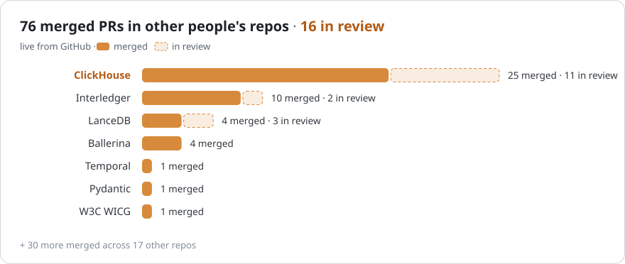

  <a href="https://jaypokale.me"><picture>
    <source media="(prefers-color-scheme: dark)" srcset="https://raw.githubusercontent.com/JayPokale/JayPokale/output/hero-dark.svg">
    
  </picture></a>

  <a href="https://jaypokale.me"><picture> <source media="(prefers-color-scheme: dark)" srcset="https://raw.githubusercontent.com/JayPokale/JayPokale/output/link-site-dark.svg">  </picture></a>
  <a href="https://www.linkedin.com/in/JayPokale"><picture> <source media="(prefers-color-scheme: dark)" srcset="https://raw.githubusercontent.com/JayPokale/JayPokale/output/link-linkedin-dark.svg">  </picture></a>
  <a href="https://x.com/JayPokale35"><picture> <source media="(prefers-color-scheme: dark)" srcset="https://raw.githubusercontent.com/JayPokale/JayPokale/output/link-x-dark.svg">  </picture></a>
  <a href="https://leetcode.com/u/jaypokale"><picture> <source media="(prefers-color-scheme: dark)" srcset="https://raw.githubusercontent.com/JayPokale/JayPokale/output/link-leetcode-dark.svg">  </picture></a>
  <a href="https://codeforces.com/profile/rdx_panther"><picture> <source media="(prefers-color-scheme: dark)" srcset="https://raw.githubusercontent.com/JayPokale/JayPokale/output/link-codeforces-dark.svg">  </picture></a>
  <a href="https://dev.to/jaypokale"><picture> <source media="(prefers-color-scheme: dark)" srcset="https://raw.githubusercontent.com/JayPokale/JayPokale/output/link-devto-dark.svg">  </picture></a>
  <a href="https://dare2solve.jaypokale.me"><picture> <source media="(prefers-color-scheme: dark)" srcset="https://raw.githubusercontent.com/JayPokale/JayPokale/output/link-dare2solve-dark.svg">  </picture></a>
  <a href="mailto:jay.pokale.35@gmail.com"><picture> <source media="(prefers-color-scheme: dark)" srcset="https://raw.githubusercontent.com/JayPokale/JayPokale/output/link-email-dark.svg">  </picture></a>

  <a href="https://github.com/search?q=is%3Apr+is%3Amerged+author%3AJayPokale+org%3AClickHouse+org%3Ainterledger+org%3Alancedb+org%3Alance-format+org%3Aballerina-platform+org%3Atemporalio+org%3Apydantic+org%3AWICG&type=pullrequests"><picture>
    <source media="(prefers-color-scheme: dark)" srcset="https://raw.githubusercontent.com/JayPokale/JayPokale/output/upstream-dark.svg">
    
  </picture></a>

  <a href="https://github.com/JayPokale/Chisle"><picture>
    <source media="(prefers-color-scheme: dark)" srcset="https://raw.githubusercontent.com/JayPokale/JayPokale/output/chisle-dark.svg">
    
  </picture></a>

  <a href="https://jaypokale.me"><picture>
    <source media="(prefers-color-scheme: dark)" srcset="https://raw.githubusercontent.com/JayPokale/JayPokale/output/research-dark.svg">
    
  </picture></a>

  <picture>
    <source media="(prefers-color-scheme: dark)" srcset="https://raw.githubusercontent.com/JayPokale/JayPokale/output/stack-dark.svg">
    
  </picture>

  <a href="mailto:jay.pokale.35@gmail.com"><picture>
    <source media="(prefers-color-scheme: dark)" srcset="https://raw.githubusercontent.com/JayPokale/JayPokale/output/closing-dark.svg">
    
  </picture></a>

