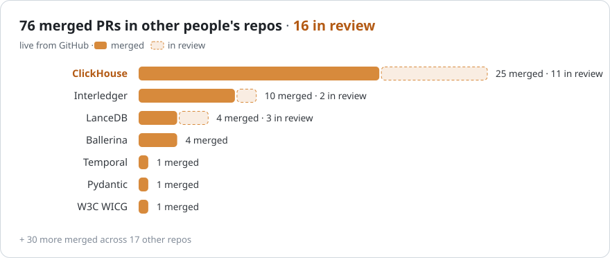

  <picture>
    <source media="(prefers-color-scheme: dark)" srcset="https://raw.githubusercontent.com/JayPokale/JayPokale/output/hero-dark.svg">
    
  </picture>

  <a href="https://jaypokale.me"><picture> <source media="(prefers-color-scheme: dark)" srcset="https://raw.githubusercontent.com/JayPokale/JayPokale/output/link-site-dark.svg">  </picture></a>
  <a href="https://www.linkedin.com/in/JayPokale"><picture> <source media="(prefers-color-scheme: dark)" srcset="https://raw.githubusercontent.com/JayPokale/JayPokale/output/link-linkedin-dark.svg">  </picture></a>
  <a href="https://x.com/JayPokale35"><picture> <source media="(prefers-color-scheme: dark)" srcset="https://raw.githubusercontent.com/JayPokale/JayPokale/output/link-x-dark.svg">  </picture></a>
  <a href="https://leetcode.com/u/jaypokale"><picture> <source media="(prefers-color-scheme: dark)" srcset="https://raw.githubusercontent.com/JayPokale/JayPokale/output/link-leetcode-dark.svg">  </picture></a>
  <a href="https://codeforces.com/profile/rdx_panther"><picture> <source media="(prefers-color-scheme: dark)" srcset="https://raw.githubusercontent.com/JayPokale/JayPokale/output/link-codeforces-dark.svg">  </picture></a>
  <a href="https://dev.to/jaypokale"><picture> <source media="(prefers-color-scheme: dark)" srcset="https://raw.githubusercontent.com/JayPokale/JayPokale/output/link-devto-dark.svg">  </picture></a>
  <a href="https://dare2solve.jaypokale.me"><picture> <source media="(prefers-color-scheme: dark)" srcset="https://raw.githubusercontent.com/JayPokale/JayPokale/output/link-dare2solve-dark.svg">  </picture></a>
  <a href="mailto:jay.pokale.35@gmail.com"><picture> <source media="(prefers-color-scheme: dark)" srcset="https://raw.githubusercontent.com/JayPokale/JayPokale/output/link-email-dark.svg">  </picture></a>

  <picture>
    <source media="(prefers-color-scheme: dark)" srcset="https://raw.githubusercontent.com/JayPokale/JayPokale/output/stats-dark.svg">
    
  </picture>

  <a href="https://github.com/JayPokale/Chisle">
    <picture>
      <source media="(prefers-color-scheme: dark)" srcset="https://raw.githubusercontent.com/JayPokale/Chisle/main/assets/readme/banner-dark.svg">
      
    </picture>
  </a>

  <a href="https://github.com/pulls?q=is%3Apr+author%3AJayPokale+-user%3AJayPokale"><picture>
    <source media="(prefers-color-scheme: dark)" srcset="https://raw.githubusercontent.com/JayPokale/JayPokale/output/upstream-dark.svg">
    
  </picture></a>

  <picture>
    <source media="(prefers-color-scheme: dark)" srcset="https://raw.githubusercontent.com/JayPokale/JayPokale/output/about-dark.svg">
    
  </picture>

  <picture>
    <source media="(prefers-color-scheme: dark)" srcset="https://raw.githubusercontent.com/JayPokale/JayPokale/output/contrib-dark.svg">
    
  </picture>

  <picture>
    <source media="(prefers-color-scheme: dark)" srcset="https://raw.githubusercontent.com/JayPokale/JayPokale/output/stack-dark.svg">
    
  </picture>

  <picture>
    <source media="(prefers-color-scheme: dark)" srcset="https://raw.githubusercontent.com/JayPokale/JayPokale/output/lift-dark.svg">
    
  </picture>

